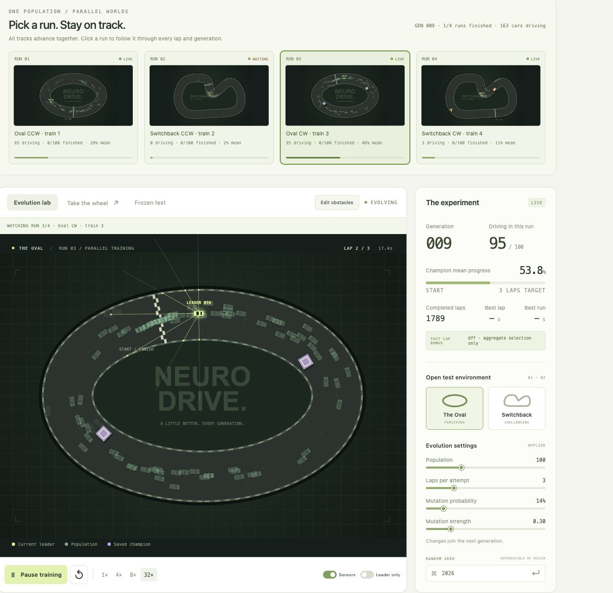

# NeuroDrive

Um playground local de neuroevolução: carros com cérebros aleatórios aprendem a completar uma pista. TypeScript, Vite, HTML Canvas e um Web Worker. Toda a simulação, o treino e os dados ficam no navegador.



Não precisa de conta, chave de API, arquivo `.env`, backend nem banco de dados. Depois de instalar as dependências, o app pode rodar sem acesso à internet. A interface está em inglês; este guia está em português.

## Conteúdo

- [Começar em poucos comandos](#começar-em-poucos-comandos)
- [Comandos do Makefile](#comandos-do-makefile)
- [Primeiro teste e controles](#primeiro-teste-e-controles)
- [Recursos do playground](#experimentar)
- [O que a rede recebe, decide e aprende](#como-funciona)
- [Métricas para acompanhar a melhora](#qual-métrica-mostra-melhora)
- [Experimentos de generalização](#comparação-reproduzível-cenário-fixo--diversidade)
- [Verificações e experimentos em cenário fixo](#verificações-e-experimentos-anteriores-em-cenário-fixo)
- [Dados locais e credenciais](#dados-locais-e-credenciais)
- [Solução de problemas](#solução-de-problemas)
- [Estrutura e limites](#estrutura-e-limites)

## Começar em poucos comandos

### Requisitos

- **Node.js 22.12 ou superior**, com npm. Verificado neste projeto com Node.js **22.22.2** e npm **10.9.7**.
- **Git**, para clonar o repositório.
- **Make**, para os atalhos abaixo. Verificado com GNU Make **3.81**. Sem Make, use a alternativa com npm.
- Um navegador com suporte a módulos JavaScript, Canvas e Web Workers. A direção manual exige teclado.

### Com Make

```sh
git clone https://github.com/willianmrs/neuro-drive.git
cd neuro-drive
make dev
```

Na primeira execução, `make dev` instala as dependências com `npm ci`, usando o `package-lock.json`, e inicia o Vite. Nas próximas execuções, reutiliza a instalação enquanto `package.json` e `package-lock.json` não forem mais recentes que o lockfile da instalação.

Abra [http://127.0.0.1:5173](http://127.0.0.1:5173). Encerre o servidor com **Ctrl+C** no terminal. Se a porta estiver ocupada, escolha outra:

```sh
make dev PORT=5174
```

Nesse caso, abra [http://127.0.0.1:5174](http://127.0.0.1:5174). Os atalhos do Make usam `--strictPort`: se a porta escolhida estiver ocupada, o comando informa o erro em vez de trocar de porta automaticamente.

### Sem Make

```sh
npm ci
npm run dev
```

Abra a URL local mostrada pelo Vite. Essa alternativa também funciona no Windows com Node.js e npm instalados; o Makefile usa um shell compatível com POSIX, disponível no macOS, Linux e em ambientes como WSL.

### Testar a versão de produção

```sh
make preview
```

O comando verifica TypeScript, compila o app em `dist/` e serve o resultado em [http://127.0.0.1:4173](http://127.0.0.1:4173). Para trocar a porta, use `make preview PREVIEW_PORT=4174`. Com npm:

```sh
npm run build
npm run preview
```

O preview serve para conferir o build local. Use um servidor HTTP; abrir `index.html` diretamente não carrega os módulos e o worker. `dist/` contém os arquivos estáticos gerados, incluindo o worker.

## Comandos do Makefile

Execute `make` ou `make help` para listar os atalhos. Os comandos que executam o projeto instalam dependências automaticamente quando necessário.

| Comando | Resultado |
| --- | --- |
| `make dev` ou `make run` | Inicia o servidor de desenvolvimento com recarga automática. |
| `make install` | Reinstala exatamente as dependências do lockfile com `npm ci`. |
| `make test` | Executa os testes do simulador, da evolução e das métricas. |
| `make build` | Verifica TypeScript e gera o build em `dist/`. |
| `make check` | Executa testes e build. |
| `make preview` | Gera o build e abre um servidor local para a versão compilada. |
| `make experiment` | Executa o treino headless no cenário fixo. |
| `make compare` | Compara os métodos fixo e diverso com o mesmo orçamento de episódios. |
| `make clean` | Remove somente `dist/`; mantém dependências e resultados dos experimentos. |

### Personalizar os experimentos

```sh
# Uma seed, uma volta, dez gerações no Oval sem obstáculos.
make experiment GENERATIONS=10 SEEDS=42 TRACK=oval LAYERS=12 LAPS=1 LAYOUT=clear

# Switchback com duas camadas ocultas e barreiras.
make experiment GENERATIONS=10 SEEDS=2026 TRACK=technical LAYERS=12,8 LAPS=3 LAYOUT=barriers

# Comparação curta entre treino fixo e diverso.
make compare DIVERSITY_GENERATIONS=6 SEEDS=42 POPULATION=40
```

| Variável | Padrão | Usada por |
| --- | --- | --- |
| `HOST` | `127.0.0.1` | `dev`, `run`, `preview`. |
| `PORT` | `5173` | `dev`, `run`. |
| `PREVIEW_PORT` | `4173` | `preview`. |
| `GENERATIONS` | `40` | `experiment`. |
| `SEEDS` | `neurodrive,42,2026` | `experiment`, `compare`; lista separada por vírgulas. |
| `TRACK` | `oval` | `experiment`; aceita `oval` ou `technical`. |
| `LAYERS` | `12` | `experiment`; neurônios das camadas ocultas, separados por vírgulas. |
| `LAPS` | `3` | `experiment`; de 1 a 10 voltas. |
| `LAYOUT` | `barriers` | `experiment`; aceita `clear` ou `barriers`. |
| `DIVERSITY_GENERATIONS` | `24` | `compare`; o método fixo roda quatro vezes esse número de gerações. |
| `POPULATION` | `40` | `compare`; de 20 a 300 carros. O experimento fixo usa população 100. |
| `NPM` | `npm` | Permite indicar outro caminho para o executável npm. |

Os experimentos escrevem em `results/` e podem substituir os JSON correspondentes à mesma configuração, além dos relatórios consolidados. Copie os resultados que quiser preservar antes de repetir uma execução. `make compare` usa **uma volta por episódio**, independentemente de `LAPS`, e não altera a sessão aberta no navegador. Esses comandos rodam no terminal e podem levar algum tempo.

## Primeiro teste e controles

1. Abra o app com `make dev`. O treino já começa em **Evolution lab**, com 100 redes, três voltas por tentativa e quatro pistas simultâneas por geração. Cada rede tem uma cópia do carro em cada pista.
2. Clique em uma miniatura de **Pick a run. Stay on track.** para escolher a pista principal. A câmera continua nessa pista entre voltas e gerações. Selecione **8×** ou **32×** para avançar mais ticks de simulação. Os carros baterem nas primeiras gerações é esperado: os pesos iniciais são aleatórios.
3. Acompanhe **More drivers making it home** e **Drive beyond one layout**. No modo diverso, espere a bateria inteira terminar antes de comparar gerações.
4. Salve o melhor cérebro no painel **Champion** e exporte o JSON para levar o modelo para outro navegador.
5. Importe, por exemplo, [`results/transfer-diverse-2026.json`](results/transfer-diverse-2026.json) para experimentar um campeão já treinado. O app não carrega os exemplos automaticamente. Use **Replay original** para reproduzir um cenário de origem ou **Test current environment** para testar o layout aberto com os mesmos pesos.
6. Use **Edit obstacles** para criar, arrastar ou girar barreiras e avaliar a transferência. No treino diverso, o editor modifica o ambiente aberto para teste; a bateria de treino continua fixa.
7. Escolha **Take the wheel**, clique na pista para dar foco ao teclado e dirija com a mesma física dos carros da rede.

| Controle | Ação |
| --- | --- |
| W / ↑ | Acelerar no modo manual. |
| S / ↓ | Frear; depois, engatar ré. |
| A / ← e D / → | Esterçar à esquerda e à direita. |
| Espaço | Pausar ou retomar quando o foco não está em um campo/controle. |
| R | Reiniciar a tentativa manual ou o teste congelado, com foco na pista. |
| R / Shift+R no editor | Girar o obstáculo selecionado em +15° / −15°, com foco na pista. |
| Delete / Backspace no editor | Remover o obstáculo selecionado quando não estiver digitando em um campo. |
| Esc no editor | Cancelar a edição. |

O **carro verde-limão** é o líder da população atual. O **carro roxo** é o fantasma do campeão salvo, reproduzindo pesos congelados quando está habilitado e disponível naquele modo. Ele não participa da seleção da população atual. Os carros não colidem uns com os outros.

## Experimentar

- **Evolution lab:** começa com 100 controladores aleatórios e, por padrão, quatro cenários executados simultaneamente por geração. As miniaturas mostram todas as pistas, carros ativos, conclusões e progresso médio; clique para escolher qual ampliar. A câmera escolhida permanece estável entre voltas e gerações. Uma pista encerrada fica em **WAITING** até as outras terminarem. Pause, reinicie ou acelere para 4×, 8× ou 32×. A aceleração executa mais ticks de 1/60 s.
- **Take the wheel:** WASD ou setas; W/↑ acelera, S/↓ freia e permite ré, A/D ou ←/→ esterçam. Espaço pausa; R reinicia a corrida. Clique na pista para focar o teclado. O treino fica pausado durante a direção manual.
- **A very small brain:** adicione/remova camadas ocultas e edite o número de neurônios. Limites: **1–4 camadas ocultas, 1–24 neurônios por camada**. Enter ou uma breve pausa aplica a edição. Alterar a arquitetura reinicia a população usando a seed atual. Entradas (8) e saídas (2) permanecem fixas; o padrão é **8 → 12 → 2**, com 134 pesos e biases.
- **Evolution settings:** **Laps per attempt** define **1–10 voltas**, com **3 por padrão**. População e mutação também entram na próxima geração. Ao trocar a meta de voltas, os cérebros continuam evoluindo; pontuações e histórico recomeçam para a nova meta. Aplicar uma seed reinicia o treino de forma reproduzível.
- **Champion:** salve o melhor cérebro no armazenamento do navegador, carregue-o, exporte/importe JSON ou dispute contra seu fantasma roxo. O líder atual é verde-limão. Cada campeão preserva sua arquitetura e meta de voltas originais. A corrida manual contra um campeão usa essa mesma meta; sem campeão, usa a meta ativa do treino. Importações validam versão, arquitetura, física, quantidade e limites dos pesos e metadados. Arquivos antigos de versão 1 são compatíveis; arquivos de versões 1 e 2 são migrados para corridas de uma volta. Novas exportações usam versão 6 e guardam arquitetura, meta, pesos, tempos, condições exatas de cada cenário e avaliação agregada; podem incluir o teste reservado concluído para os mesmos pesos. O limite é 250 KB. Arquivos das versões 4 e 5 mantêm seus obstáculos e comportamento originais. Arquivos de versões 1–3 continuam compatíveis com suas pistas originais sem obstáculos. **Replay original** restaura o cenário original escolhido no seletor e reproduz os pesos congelados. **Test current environment** mantém a pista/layout aberto e testa os mesmos pesos sem treino adicional. Importar um cérebro preserva o ambiente aberto; o replay original é uma ação explícita. Campeões antigos continuam utilizáveis para teste e replay, mas não ganham avaliações agregadas inventadas.
- **Edit obstacles:** adiciona, arrasta, gira e remove obstáculos de cinco formatos: barreira listrada, círculo, triângulo, bloco quadrado e barreira longa em um layout editável com limite de **24 obstáculos**. Começa com três barreiras por pista. Escolha **New shape**, clique em **+ Add obstacle** e depois no asfalto para adicionar; arraste para mover mantendo a orientação; selecione um obstáculo e use **↶ / ↷** para girar em passos de 15°, o slider **Angle** ou o campo numérico para definir 0–359°. Na pista, R gira 15° e Shift+R gira −15°; **Remove selected** ou Delete remove a seleção. **Clear all** limpa o rascunho e **Cancel** ou Esc descarta a edição. **Apply & resume** aplica o layout ao ambiente de transferência. No treino diverso, a bateria, pontuações e população permanecem inalteradas; no modo fixo, as tentativas e pontuações recomeçam com os mesmos cérebros. Edições das pistas base são salvas no navegador. Um replay original com geometria/largada particular é um ambiente temporário da sessão. O treino pausa durante a edição; se já estava pausado, continua pausado após aplicar. A largada fica protegida e as barreiras precisam caber no asfalto. Os sensores e a colisão orientada detectam as barreiras.
- **Every connection has a weight:** o painel abaixo mostra matrizes dos pesos e vieses de cada camada. Escolha o melhor resultado do treino, um dos três primeiros da geração ou o campeão salvo. Azul significa positivo; laranja, negativo; a intensidade representa o módulo relativo ao maior parâmetro daquela rede. O sinal não significa bom/ruim. Linhas recebem sinais das colunas. Clique no nome de um neurônio para inspecionar a soma e a saída `tanh`; nos líderes atuais, são usados os inputs da última decisão real. Resultados armazenados mostram apenas os pesos, sem inventar ativações. **Freeze view** congela o cérebro e os inputs para leitura, sem pausar a simulação; uma nova inicialização libera a inspeção congelada. No modo diverso, editar o ambiente aberto não muda a comparação da bateria de treino.
- **More drivers making it home:** acompanha a qualidade de toda a população, com taxa de conclusão, tempo total mediano entre quem concluiu, progresso médio e colisões. Por padrão, usa a última geração encerrada. **Current generation** mostra resultados provisórios, com o número de carros ainda ativos. O funil detalha 5% da primeira volta e cada volta concluída. O gráfico e a tabela mantêm até 240 gerações no histórico e exibem as últimas 10 na tabela.
- **Test other track:** abre a outra pista e executa o cérebro salvo congelado. No treino diverso, trocar o ambiente de teste não muda a bateria. O treino pausa durante os testes congelados ou a direção manual.

## Como funciona

Sete raycasts em um campo frontal de 180° e a velocidade normalizada alimentam a mesma rede feedforward com `tanh` e duas saídas de direção e aceleração/frenagem. A arquitetura e as oito entradas existentes foram mantidas.

### Uma decisão por tick de simulação

Cada carro tem sua própria cópia dos pesos. A cada **1/60 de segundo simulado**, o simulador lê os sensores, executa a rede e aplica as duas ações à física. Isso acontece uma vez por tick, sem depender da taxa de quadros da tela; a aceleração do treino executa mais ticks. As subdivisões usadas para verificar colisões mantêm a ação daquele tick.

| Sinal | Valores e significado |
| --- | --- |
| Entradas 1–7 | Distância normalizada até a borda/obstáculo nos ângulos −90°, −60°, −30°, 0°, +30°, +60° e +90° em relação ao carro. `0` indica contato; `1`, nenhuma interseção no alcance de 215 unidades. |
| Entrada 8 | Velocidade dividida pela velocidade máxima, limitada a `[-1, 1]`; negativa em ré. |
| Saída 1 | Esterçamento contínuo: `−1` à esquerda, `0` reto, `+1` à direita. |
| Saída 2 | Aceleração/frenagem contínua: `+1` acelera; valores negativos freiam o movimento para a frente e permitem ré. |

A rede não recebe posição na pista, checkpoints, número de voltas, pontuação ou uma trajetória ideal. Ela não tem memória recorrente. Posição, orientação, relógios e checkpoints pertencem ao simulador e à avaliação, não às entradas do controlador.

### O que muda entre gerações

Os pesos ficam **fixos durante cada tentativa**. Não há ajuste por backpropagation a cada colisão nem um professor indicando a direção correta. A melhora vem da seleção dos controladores que tiveram melhores resultados e das mutações dos seus descendentes.

Ao fim da avaliação, cerca de **4% da população, com mínimo de dois carros**, passa sem mutação. Os pais do restante vêm dos **25% mais bem classificados**: um torneio sorteia três posições desse grupo e escolhe a melhor. Cada descendente copia um pai e cada parâmetro pode receber ruído gaussiano conforme a probabilidade e a intensidade configuradas; pesos e vieses ficam limitados a `[-6, 6]`. Não há cruzamento de dois pais. No padrão, a mutação tem probabilidade de **14% por parâmetro** e intensidade **0,30**.

Não existe recompensa explícita por ficar no centro da pista. O objetivo considera progresso válido, conclusões e tempo. Evitar bordas pode surgir como comportamento útil, mas o centro não é uma linha obrigatória nem necessariamente o trajeto mais rápido.

### Cenários, classificação e generalização

As runs são simultâneas no tempo da simulação e são intercaladas em um único Web Worker. Isso mantém a interface livre do cálculo do treino; não cria um worker por pista nem promete uso de vários núcleos. Com 100 redes e quatro cenários, existem 400 episódios carro × cenário por geração. O custo de um tick aumenta com a quantidade de pistas, carros e neurônios.

No modo **Diverse scenarios**, cada genoma enfrenta a bateria completa de **4–6 cenários em paralelo**. Há uma cópia independente de cada carro em cada pista, com o mesmo genoma e seu próprio estado físico. Todos os cenários avançam um passo de 1/60 s por tick; carros encerrados mantêm seu resultado enquanto os demais continuam. Cada carro completa toda a meta de voltas na sua pista. As pistas ficam fixas ao longo das gerações, e a seleção só acontece quando todos os carros de todas as pistas terminam. A geração seguinte reinicia todas as pistas juntas com os novos genomas.

A classificação compara, nesta ordem: fração de cenários concluídos, progresso médio normalizado, progresso no pior cenário e tempo médio por distância entre as conclusões. Progresso parcial continua útil antes das primeiras conclusões. Pais por torneio, elites e campeão usam essa classificação. **Não existe bônus de uma volta isolada no modo diverso.** No modo **Fixed current environment**, o algoritmo original e o bônus da volta mais rápida continuam disponíveis para comparação.

As baterias ficam fixas para que um recorde não seja comparado a uma bateria diferente. Uma chave canônica inclui todas as condições físicas e a meta de voltas; o comparador rejeita chaves diferentes. Mudar protocolo, quantidade ou amplitude da diversidade inicia uma nova população e comparação. Mudar a meta de voltas aguarda o fim da bateria, preserva os descendentes e limpa os recordes para a nova meta. O gerador dos cenários usa seed separada do gerador da evolução.

O conjunto de treino inclui as duas pistas, ambos os sentidos, obstáculos com posições/orientações variadas e perturbações pequenas da largada. Os primeiros dois cenários moderados são sem obstáculos, para manter sinal inicial. **Wider** acrescenta obstáculos, variações de geometria e perturbações maiores. Cada candidato de layout passa por verificações de posicionamento e por uma busca de corredor fechado com o carro orientado e varreduras de colisão. Isso considera bloqueios conjuntos. É um teste conservador de folga geométrica, não uma prova de controlabilidade dinâmica; layouts desenhados livremente para testar transferência podem bloquear a pista.

Os **seis cenários reservados** usam outro fluxo de aleatoriedade, novos layouts, largadas e pequenas alterações na geometria. O campeão é avaliado com cópia congelada dos pesos, sem tocar em pais, mutações ou RNG da evolução. O worker executa esse teste separadamente. A interface identifica a geração, a origem (campeão do treino ou salvo) e a meta de voltas do modelo avaliado. Se um campeão mais novo surgir durante o teste, o resultado anterior continua identificado e o novo aguarda sua vez. Um teste manual do salvo permanece identificado como tal até reiniciar o protocolo.

O painel de miniaturas mostra todas as runs em andamento e permite selecionar a câmera sem alterar pesos, relógios, seed, ranking, métricas ou a pausa. A pista selecionada continua escolhida após a troca de geração. **Drive beyond one layout** mostra a run observada, quantas pistas terminaram, avaliação agregada e resultados reservados por cenário. O quadro de gerações usa **episódios carro × cenário** como denominador no modo diverso e não mistura tempos brutos de pistas diferentes. Ele também informa quantos carros concluíram toda a bateria. Tempos normalizados são expressos em segundos por 1.000 unidades da pista, apenas para conclusões.

A física arcade não inclui perda de aderência nem derrapagem. Usa passo fixo de 60 Hz, arrasto, frenagem, velocidade limitada e esterçamento proporcional ao movimento. A colisão usa um retângulo orientado e subdivisões de até 3 unidades/0,04 radianos por passo. Carros colidem com bordas e barreiras, e não colidem entre si. O treino e o modo manual chamam a mesma função `stepCar`.

Dezesseis checkpoints direcionais devem ser cruzados em ordem. Só o intervalo atual pode render progresso, com um limite superior; o maior progresso válido é preservado. Ré, oscilação e rotação não acumulam pontos repetidos. Cada volta precisa repetir os 16 checkpoints na ordem. O carro cruza a chegada mantendo posição, velocidade e direção. O progresso acumula em distância absoluta até completar todas as voltas da meta. Colisão, 4,5 s sem avanço ou um limite total de 34 s simulados por volta da meta encerram a tentativa. Completar a meta encerra com sucesso; tempos totais menores desempatam as corridas completas. A interface mostra a volta atual, melhor volta individual e melhor tempo total separadamente. O melhor cérebro permanece separado da geração atual.

## Qual métrica mostra melhora?

No modo fixo, a principal é **carros que concluíram todas as voltas ÷ população avaliada**. No modo diverso, acompanhe a fração de cenários concluídos pelo campeão, a quantidade de carros que conclui toda a bateria e o sucesso nos cenários reservados. O quadro de população mostra a taxa de conclusão dos episódios carro × cenário. Uma taxa maior mostra que o comportamento útil aparece em mais redes. Depois compare o **tempo total mediano de quem concluiu**, junto da taxa de conclusão: uma mediana menor com quase ninguém terminando pode ser enganosa. Enquanto ninguém conclui, acompanhe o progresso médio de todos os carros e a queda nas colisões. Um único campeão é uma evidência mais limitada que a população inteira.

As taxas sempre usam a população realmente avaliada naquela geração, mesmo se o controle de população mudar na geração seguinte. Progresso é a distância válida dividida pela distância total da meta. A dispersão do progresso é o desvio padrão populacional, mostrado em pontos percentuais. Diversidade dos pesos é a raiz da média das variâncias populacionais de cada parâmetro, incluindo vieses. Diversidade menor indica pesos mais parecidos, sem garantir comportamento melhor. A tendência compara a média das taxas de conclusão das últimas cinco gerações encerradas com as cinco anteriores, após haver dez gerações.

No modo fixo, compare a mesma pista, layout e meta. No modo diverso, compare a mesma bateria e meta; mudar apenas o ambiente aberto para transferência preserva esse histórico. Alterações na arquitetura/seed ou protocolo reiniciam a população. Esses números mostram o aprendizado nesse cenário de treino e não substituem testar o campeão em outro cenário.

## Comparação reproduzível: cenário fixo × diversidade

```sh
node --import tsx scripts/compare-diversity.ts 24 neurodrive,42,2026 40
```

Mesmas seeds iniciais, rede 8 → 12 → 2, população 40, mutação 14% / força 0,30, **uma volta por episódio**. Cada método recebe **3.840 episódios de treino por seed**: cenário fixo por 96 gerações; quatro cenários diversos por 24 gerações. O fixo treina apenas no Oval original livre. O diverso treina a bateria moderada. Após o treino, ambos são avaliados nos mesmos quatro cenários de treino diversos e nos mesmos seis cenários reservados daquela seed. Nenhum desses testes escolhe o campeão do método fixo; o diverso também nunca usa o reservado para seleção. São três comparações pareadas, não 18 circuitos base independentes.

| Seed | Treino próprio fixo / diverso | Bateria comum: fixo / diverso | Reservados: fixo / diverso | Progresso médio reservado: fixo / diverso | Tempo de treino local: fixo / diverso |
| --- | --- | --- | --- | --- | --- |
| neurodrive | 1/1 · 3/4 | 0/4 · 3/4 | 0/6 · 5/6 | 7,0% · 93,2% | 8,75 s · 12,55 s |
| 42 | 1/1 · 4/4 | 1/4 · 4/4 | 0/6 · 4/6 | 10,5% · 88,5% | 9,12 s · 13,16 s |
| 2026 | 1/1 · 4/4 | 1/4 · 4/4 | 0/6 · 5/6 | 8,4% · 92,4% | 8,93 s · 16,14 s |

O sucesso reservado total passou de **0/18 para 14/18 (77,8%)**; o progresso médio passou de **8,6% para 91,4%**. O pior cenário de cada campeão diverso chegou a **54,6%–58,9%**, ainda com falhas. O método diverso usou aproximadamente **56% mais tempo local** e **61% mais passos físicos de carros** com o mesmo orçamento de episódios, principalmente porque os carros sobrevivem mais tempo. Medidas de tempo dependem da máquina/carga; não são um benchmark isolado. No aplicativo, os testes reservados automáticos ainda têm seu próprio custo, não incluído nesses tempos de treino headless.

Os tempos dessa tabela foram medidos antes da execução simultânea das pistas, quando os cenários eram agendados sequencialmente. São registros históricos; não medem o desempenho da interface atual. A mudança de agendamento mantém os pesos fixos por tentativa e a seleção agregada ao final da bateria.

A execução foi repetida após a correção da chave canônica de serialização: os resultados por cenário foram idênticos. Os seis campeões reais exportados passaram pelo validador. Resultados completos, condições dos cenários, tempos, número de passos e histórico estão em `results/compare-diversity.json`; os campeões são `results/transfer-{fixed,diverse}-{seed}.json`.

A evidência cobre apenas três seeds, seis cenários reservados por seed e variações de duas famílias de pistas, com folga geométrica e diversidade moderada. No navegador, o campeão `2026` que concluiu 5/6 reservados também foi testado no layout livre de oito obstáculos existente: colidiu aos 12,7% da volta. Seus 134 pesos/vieses exportados permaneceram idênticos após esse teste. Isso evidencia uma falha fora da densidade de obstáculos usada na bateria. Não prova funcionamento em qualquer circuito, em pistas estreitas, grandes perturbações ou layouts que bloqueiem a passagem. O experimento usa uma volta; as metas de 1–10 voltas continuam disponíveis no aplicativo, mas não devem receber os números deste experimento como se tivessem sido medidas.

## Verificações e experimentos anteriores em cenário fixo

```sh
npm test
npm run build
npm run experiment -- 40 neurodrive,42,2026 oval 12 1
npm run experiment -- 60 2026 technical 12 1
npm run experiment -- 40 2026 oval 12,8 1
npm run experiment -- 25 neurodrive,42,2026 oval 12 3
node --import tsx scripts/generalization.ts
node --import tsx scripts/replay-multilap.ts
npm run experiment -- 40 neurodrive,42,2026 oval 12 3 barriers
node --import tsx scripts/replay-multilap.ts barriers
```

Os argumentos de `experiment` são: gerações, seeds separadas por vírgula, pista, tamanhos das camadas ocultas, meta de voltas e layout (`clear` ou `barriers`). A meta padrão é 3; os novos resultados usam o sufixo `-fastlap`, registram a política de seleção e distinguem metas e layouts (`-barriers`) para preservar os experimentos anteriores de uma volta. Os arquivos JSON em `results/` registram seeds, configurações, arquiteturas, histórico por geração, resultados e campeões exportáveis. Esses comandos legados avaliam um ambiente fixo. O treino inicia com pesos aleatórios; os campeões desses experimentos só entram no app por importação explícita.

Configuração dos experimentos: população 100, mutação 14%, intensidade 0,30. A tabela abaixo registra os experimentos originais, **com meta de uma volta**, em tempo simulado:

| Pista / rede | Seed | Gerações | Voltas completas na geração 1 → final | Progresso médio na geração 1 → final | Melhor volta |
| --- | --- | ---: | ---: | ---: | ---: |
| Oval / 8–12–2 | neurodrive | 40 | 2 → 55 | 7,2% → 59,3% | 7,98 s |
| Oval / 8–12–2 | 42 | 40 | 1 → 60 | 5,9% → 64,1% | 7,98 s |
| Oval / 8–12–2 | 2026 | 40 | 0 → 49 | 3,4% → 53,3% | 8,00 s |
| Switchback / 8–12–2 | 2026 | 60 | 0 → 64 | 3,3% → 68,2% | 10,10 s |
| Oval / 8–12–8–2 | 2026 | 40 | 2 → 66 | 6,5% → 69,4% | 7,97 s |

Nos experimentos originais de uma volta, a seed `2026` completa sua primeira volta no Oval na geração 3 e em Switchback na geração 12. A pista Oval é ampla: algumas populações aleatórias já produzem voltas na primeira geração. A melhoria também aparece no tempo e na proporção de carros que concluem.

Os três campeões do Oval reproduziram exatamente os tempos exportados ao serem carregados no mesmo simulador. Transferidos sem treino para Switchback, atingiram apenas **4,1%–8,1%**, todos encerrando por colisão. Aprender uma pista não garantiu generalização.

Com a nova meta de **3 voltas**, após 25 gerações no Oval, as seeds `neurodrive`, `42` e `2026` concluíram corridas em **21,95 s**, **21,90 s** e **22,00 s**, respectivamente. Na geração 25, **60/100**, **58/100** e **56/100** carros completaram as três voltas. Os resultados completos estão em `results/experiments-laps3.json`; os campeões de versão 3 guardam a meta e podem ser reproduzidos com `scripts/replay-multilap.ts`. Os três reproduziram exatamente o tempo exportado e também completaram 10 voltas contínuas, entre 70,63 s e 70,92 s, sem reposicionar o carro entre voltas.

Com as **três barreiras padrão** e bônus da volta rápida, após 40 gerações, as seeds `neurodrive`, `42` e `2026` completaram três voltas em **22,13 s**, **22,08 s** e **22,12 s**. Na geração final, **48/100**, **56/100** e **37/100** carros completaram toda a meta. O histórico, layout exato e campeões ficam em `results/experiments-laps3-fastlap-barriers.json` e arquivos associados.

**46 testes automatizados** cobrem raios, colisões orientadas, movimento, checkpoints e direção, proteção contra pontuação repetida, saídas da rede, mutação, elites, determinismo, arquiteturas configuráveis, limites, continuidade entre voltas, proteção contra repetir a linha de chegada, ranking de várias voltas, tempo limite proporcional, mudanças na meta por geração, serialização/migração de campeões, bônus da melhor volta, sensores/colisões com obstáculos, posições inválidas, reconstrução da geometria após edição e preservação de cérebros ao aplicar layouts, cinco formatos girados com sensores/colisões, serialização de formatos, migração da versão 4, ordem exata dos pesos/vieses, cálculo das taxas/medianas/diversidade, denominadores antes de alterações na população, igualdade de cenários entre genomas, reinício físico, espera da bateria, seleção agregada, rejeição de comparações entre baterias, isolamento dos testes reservados/RNG, pesos congelados, preservação do layout de transferência e serialização agregada. Os testes também verificam avanço simultâneo, estados independentes, espera por pistas que terminam fora de ordem, permanência da câmera entre gerações, isolamento da seleção da câmera e denominadores após mudar a população. O build passa com verificação TypeScript. No navegador foram verificados treino acelerado, pausa/retomada, mudanças pendentes, direção manual, teclado, troca de pistas, sensores, visualização do líder, armazenamento, exportação/importação, rejeição de JSON inválido, controles de camadas, meta de voltas aplicada na próxima geração e corridas contínuas com várias voltas e edição por clique/arraste, remoção, clear-all, cancelamento e retorno de posições inválidas, criação dos cinco formatos, rotação, fontes dos pesos, cálculo do neurônio e congelamento da inspeção. Também foram conferidos importação de um campeão agregado real, preservação dos oito obstáculos ao testar no ambiente aberto, replay explícito dos quatro obstáculos de um campeão antigo e avaliação reservada do campeão salvo. O layout também foi conferido a 390 px, sem rolagem horizontal da página.

## Dados locais e credenciais

O aplicativo não usa chaves de API nem autenticação. Treino e inferência rodam no navegador; os scripts de experimento rodam no Node.js. Não há telemetria nem envio dos modelos para um serviço remoto. A instalação inicial consulta o registro de pacotes npm; os servidores de desenvolvimento e preview atendem localmente por padrão.

Campeões e layouts salvos usam `localStorage`. São separados por origem do navegador, incluindo host e porta: `localhost:5173`, `127.0.0.1:5173` e `127.0.0.1:5174` têm armazenamentos diferentes. O histórico da sessão e a população em andamento ficam em memória e são perdidos ao recarregar. Exporte o campeão como JSON antes de limpar os dados do navegador ou mudar de origem.

A revisão com **Gitleaks 8.30.1**, no histórico Git e nos arquivos preparados para publicação, não encontrou credenciais. O `.gitignore` exclui `.env`, variantes locais de `.env`, `.npmrc`, arquivos de chaves/certificados privados, dependências e builds. Nenhum `.env` precisa ser criado para executar o projeto. Variáveis com prefixo `VITE_` podem ser incluídas no JavaScript entregue ao navegador; não devem conter credenciais privadas.

## Solução de problemas

| Problema | O que fazer |
| --- | --- |
| `make: command not found` | Use `npm ci` e `npm run dev`, ou disponibilize Make em um shell POSIX. |
| Node incompatível ou npm ausente | Confira `node --version` e `npm --version`; use Node.js 22.12+ com npm. |
| Dependências ausentes ou instalação danificada | Rode `make install` ou `npm ci`. O lockfile faz parte do repositório. |
| A porta já está ocupada | Use `make dev PORT=5174` ou `make preview PREVIEW_PORT=4174` e abra a nova URL. |
| Página aberta como `file://` ou worker não inicia | Inicie o servidor HTTP com `make dev`; não abra o HTML diretamente. Confira também o erro no console do navegador. |
| As teclas não controlam o carro | Escolha **Take the wheel** e clique na pista. Campos de formulário mantêm o foco para edição. |
| O campeão salvo desapareceu | Confira host, porta e perfil do navegador. Reimporte o JSON se mudou de origem ou limpou os dados. |
| O treino não chega a 32× | Reduza população, camadas, neurônios ou velocidade. O ritmo depende da máquina; o passo da física continua fixo. |
| Muitos carros ainda batem | Compare gerações completas na mesma bateria, acompanhe progresso e conclusões e teste o campeão nos cenários reservados. Um layout livre pode bloquear a pista. |

## Estrutura e limites

| Caminho | Responsabilidade |
| --- | --- |
| `index.html`, `src/style.css` | Estrutura e aparência da interface. |
| `src/main.ts` | Eventos, persistência, modos manual e congelado, comunicação com o worker. |
| `src/protocol.ts` | Tipos das mensagens e snapshots entre interface e worker. |
| `src/training.worker.ts` | Agenda ticks de treino e testes reservados e envia snapshots. |
| `src/core/network.ts` | Arquitetura, inferência, parâmetros e mutação da rede. |
| `src/core/simulation.ts` | Sensores, ações, física, colisões, checkpoints e pontuação de uma tentativa. |
| `src/core/evolution.ts`, `src/core/diverse-evolution.ts` | População, classificação, seleção e novas gerações. |
| `src/core/scenarios.ts`, `src/core/evaluation.ts` | Baterias reproduzíveis e avaliação agregada/congelada. |
| `src/core/track.ts`, `src/core/obstacles.ts` | Geometria das pistas, sensores e formatos de obstáculos. |
| `src/core/metrics.ts`, `src/core/serialization.ts`, `src/core/transfer.ts` | Métricas, JSON validado e transferência dos campeões. |
| `src/ui/` | Renderização, editor de obstáculos, matrizes de pesos e painéis de métricas. |
| `tests/` | Testes automatizados do núcleo, executados pelo test runner do Node.js. |
| `scripts/` | Experimentos headless e reprodução dos campeões. |
| `results/` | Campeões JSON, resultados medidos e capturas da interface. |
| `Makefile` | Atalhos de instalação, execução, verificação e experimentos. |

O núcleo em `src/core/` não depende do DOM. Isso permite usar a mesma física e as mesmas regras no navegador, no worker, nos testes e nos experimentos do terminal.

A velocidade de treino é uma meta: pode ficar abaixo de 32× com populações e redes grandes, sem alterar a física. Redes maiores não garantem aprendizado melhor. O histórico visual mantém as últimas 240 gerações; a sessão de treino não é retomada após recarregar a página. Campeões são armazenados por pista e por origem do navegador (host/porta); exporte JSON para transportá-los. Pequenas diferenças numéricas entre motores JavaScript podem afetar gerações muito longas. Mais voltas selecionam controladores consistentes ao longo do circuito; isso não garante a trajetória matematicamente ótima. A física é arcade, com bordas e obstáculos de cinco formatos, fixos durante cada tentativa. O editor permite montar um bloqueio sem passagem; layouts personalizados não têm garantia automática de serem solucionáveis. A direção manual exige teclado.
